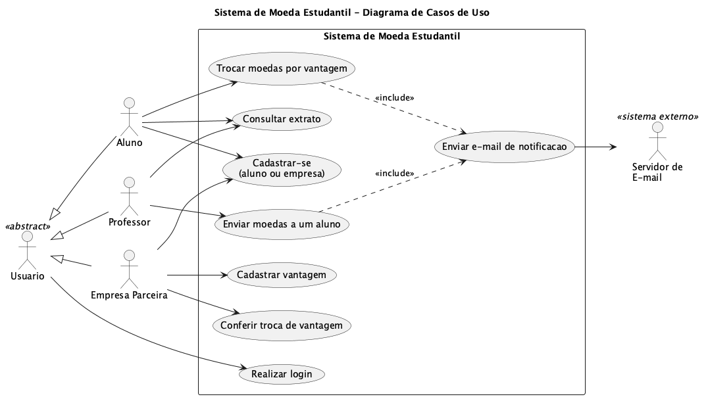
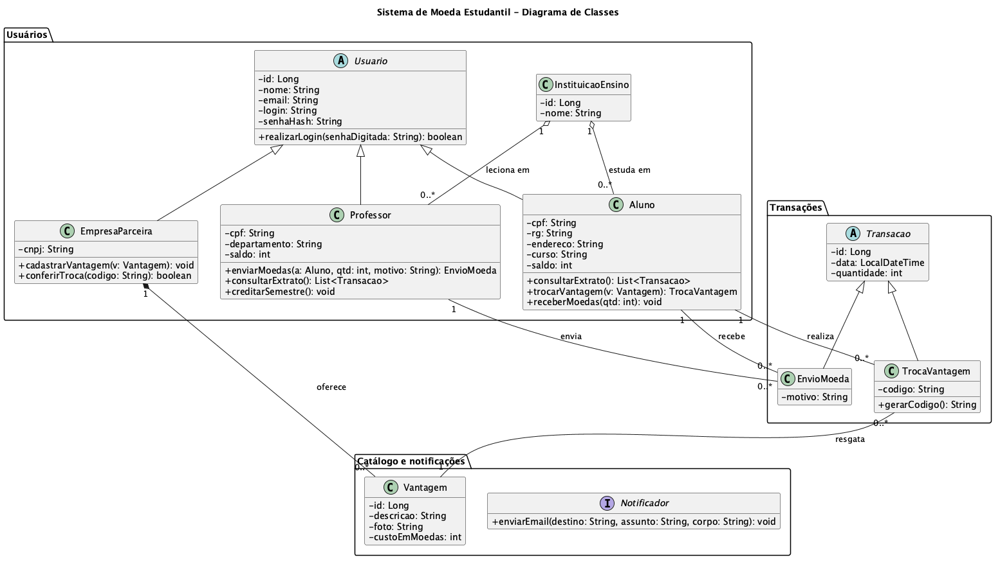
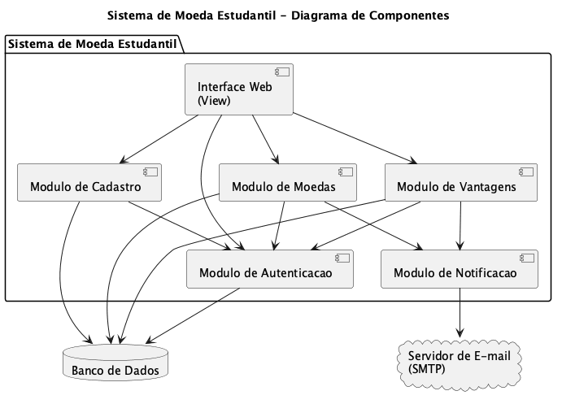
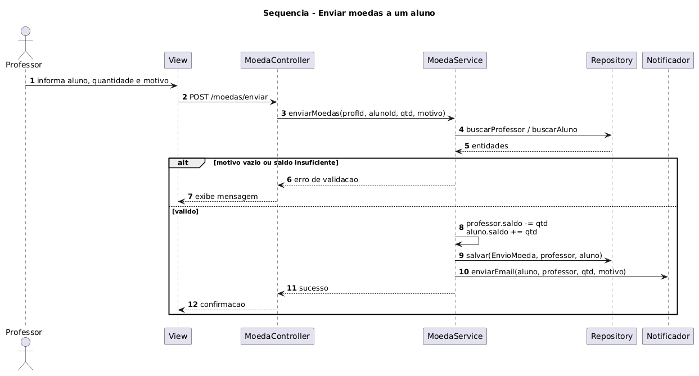
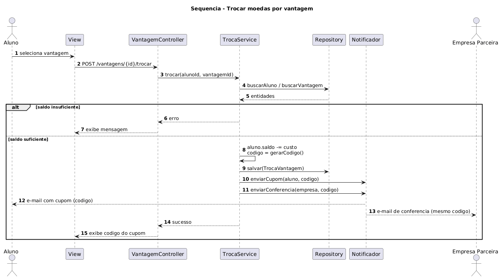

<!-- README baseado no template do Prof. Dr. João Paulo Aramuni (Lab. de Desenvolvimento de Software). -->

---

# 🪙 Sistema de Moeda Estudantil 👨‍💻

> [!NOTE]
> Plataforma que estimula o **reconhecimento do mérito estudantil** por meio de uma **moeda virtual**: professores distribuem moedas aos alunos e os alunos as trocam por **vantagens em empresas parceiras**.  

<table>
  <tr>
    <td width="800px">
      <div align="justify">
        O <b>Sistema de Moeda Estudantil</b> conecta <b>professores</b>, <b>alunos</b> e <b>empresas parceiras</b> em um ciclo de reconhecimento: cada professor recebe <b>1.000 moedas por semestre</b> (com saldo acumulável) para premiar bom comportamento e participação em aula; os alunos acumulam essas moedas e as trocam por <b>descontos e produtos</b> cadastrados pelas empresas. Cada troca gera um <b>cupom com código único</b>, enviado por e-mail ao aluno e ao parceiro. Este repositório reúne a <b>modelagem UML</b>, a <b>documentação</b> e o <b>código</b> da <b>Release 1</b>, desenvolvido em <b>arquitetura MVC</b> na disciplina de Laboratório de Desenvolvimento de Software.
      </div>
    </td>
    <td>
      <div>
        
      </div>
    </td>
  </tr> 
</table>

---

## 🚧 Status do Projeto

🟢 **Release 1 funcional (Sprint 03)** — modelagem, persistência, CRUDs e fluxo completo de moedas implementados.

[](https://github.com/fillmello/lab03_rounds/releases)
[](docs/sprints/lab03s01.md)
[](docs/diagramas)
[](#-arquitetura)
[](#-licença)

     

---

## 📚 Índice
- [Links Úteis](#-links-úteis)
- [Sobre o Projeto](#-sobre-o-projeto)
  - [Perfis de usuário](#perfis-de-usuário)
  - [Regras-chave](#regras-chave)
  - [Roadmap de Sprints](#-roadmap-de-sprints)
- [Funcionalidades Principais](#-funcionalidades-principais)
- [Tecnologias Utilizadas](#-tecnologias-utilizadas)
- [Arquitetura](#-arquitetura)
  - [Diagramas UML](#diagramas-uml)
  - [Mapeamento Componentes × MVC](#mapeamento-componentes--mvc)
- [Instalação e Execução](#-instalação-e-execução)
  - [Pré-requisitos](#pré-requisitos)
  - [Variáveis de Ambiente](#-variáveis-de-ambiente)
  - [Instalação de Dependências](#-instalação-de-dependências)
  - [Como Executar a Aplicação](#-como-executar-a-aplicação)
  - [Acessos de demonstração](#-acessos-de-demonstração)
- [Deploy](#-deploy)
- [Estrutura de Pastas](#-estrutura-de-pastas)
- [Demonstração](#-demonstração)
  - [Aplicativo Mobile](#-aplicativo-mobile)
  - [Aplicação Web](#-aplicação-web)
  - [Exemplo de saída no Terminal (para Back-end, API, CLI)](#-exemplo-de-saída-no-terminal-para-back-end-api-cli)
- [Testes](#-testes)
- [Documentações utilizadas](#-documentações-utilizadas)
- [Autores](#-autores)
- [Contribuição](#-contribuição)
- [Agradecimentos](#-agradecimentos)
- [Transparência sobre uso de IA](#-transparência-sobre-uso-de-ia)
- [Licença](#-licença)

---

## 🔗 Links Úteis
* 📦 **Repositório:** [github.com/fillmello/lab03_rounds](https://github.com/fillmello/lab03_rounds)
  > 💻 **Descrição:** Repositório oficial do grupo, com todas as versões dos modelos UML e do código.
* 🌐 **Demo Online:** _[link-da-demo-web]_ (a definir, se houver deploy)
  > 💻 **Descrição:** Link para a aplicação em ambiente de produção (Ex: hospedado na Vercel, Netlify ou AWS S3).
* 📱 **Download Mobile:** _Não se aplica na Release 1 (aplicação web)._
  > 📱 **Descrição:** Se o grupo criar um app, inclua aqui os links da App Store, Google Play ou APK direto.
* 📖 **Documentação:** [`docs/`](docs/)
  > 📚 **Descrição:** [Arquitetura e tecnologias (tutorial)](docs/tutorial_arquitetura.md) · [Requisitos e regras de negócio](docs/requisitos.md) · [Histórias do Usuário](docs/historias-de-usuario.md) · [Diagramas UML](docs/diagramas/) · [Guia da Sprint Lab03S01](docs/sprints/lab03s01.md)

---

## 📝 Sobre o Projeto

**Por que existe:** valorizar o mérito e o engajamento dos estudantes de forma tangível, criando um mecanismo simples de reconhecimento entre professores e alunos.

**Qual problema resolve:** professores não dispõem de uma forma estruturada e rastreável de reconhecer bom comportamento e participação; alunos não têm retorno concreto por esse esforço. A moeda virtual cria esse elo, e as empresas parceiras ganham visibilidade ao oferecer vantagens.

**Qual o contexto:** projeto acadêmico da disciplina de **Laboratório de Desenvolvimento de Software** (Lab03, Release 1), desenvolvido em três sprints.

**Onde pode ser utilizado:** instituições de ensino participantes (pré-cadastradas), com professores, alunos e empresas parceiras interagindo pela plataforma.

### Perfis de usuário

| Perfil | Como entra no sistema | Principais ações |
|--------|-----------------------|------------------|
| **Aluno** | Auto-cadastro (nome, e-mail, CPF, RG, endereço, instituição e curso) | Receber moedas, consultar extrato, trocar moedas por vantagens |
| **Professor** | Pré-cadastrado a partir da lista enviada pela instituição | Enviar moedas a alunos (com motivo obrigatório), consultar extrato |
| **Empresa Parceira** | Auto-cadastro | Cadastrar vantagens (descrição, foto e custo), conferir trocas pelo código |

### Regras-chave
- Cada professor recebe **1.000 moedas por semestre**; o saldo **acumula** entre semestres.
- O envio exige **saldo suficiente** e **motivo** (mensagem obrigatória).
- O aluno é **notificado por e-mail** ao receber moedas.
- Na troca, o custo é **descontado do saldo** e um **e-mail com o mesmo código** é enviado ao aluno (cupom) e à empresa (conferência).
- Todos os perfis exigem **login e senha** (autenticação obrigatória).

> [!NOTE]
> Regras completas: [`docs/requisitos.md`](docs/requisitos.md)

### 📅 Roadmap de Sprints

| Sprint | Pontos | Entregas | Status |
|--------|--------|----------|--------|
| **Lab03S01** | 6 | Casos de Uso, Histórias do Usuário, Diagrama de Classes, Diagrama de Componentes | ✅ Concluída |
| **Lab03S02** | 7 | Modelo ER, estratégia de acesso a dados (ORM/DAO), CRUD inicial de aluno e empresa parceira | ✅ Concluída |
| **Lab03S03** | 7 | CRUD final, apresentação da arquitetura e persistência, tutorial das tecnologias (~20 min) | ✅ Concluída ([tutorial](docs/tutorial_arquitetura.md)) |

---

## ✨ Funcionalidades Principais

- 🔐 **Autenticação Segura:** login com senha para aluno, professor e empresa parceira.
- 📝 **Cadastro:** auto-cadastro de alunos (com seleção de instituição pré-cadastrada) e de empresas parceiras.
- 🪙 **Distribuição de Moedas:** professor envia moedas a alunos com motivo obrigatório e validação de saldo.
- 🔄 **Crédito Semestral:** 1.000 moedas por semestre ao professor, com acúmulo do saldo restante.
- 📨 **Notificações por E-mail:** aviso ao aluno ao receber moedas e envio do cupom de troca.
- 📊 **Extrato:** saldo e histórico de transações (envios, recebimentos e trocas).
- 🎁 **Catálogo de Vantagens:** empresas cadastram vantagens com descrição, foto e custo em moedas.
- 🎟️ **Troca com Cupom:** desconto do saldo, geração de código único e conferência pela empresa parceira.

---

## 🛠 Tecnologias Utilizadas

Next.js + React + TypeScript no front-end; Python 3.12 + FastAPI + SQLAlchemy no back-end. SQLite no desenvolvimento e PostgreSQL em produção.

### 💻 Front-end

* **Framework/Biblioteca:** Next.js 15 e React 19
* **Linguagem:** TypeScript
* **Estilização:** CSS
* **Gerenciamento de Estado:** Estado local dos componentes React
* **Build Tool:** Next.js

### 🖥️ Back-end

* **Linguagem/Runtime:** Python 3.12
* **Framework:** FastAPI
* **Banco de Dados:** SQLite no desenvolvimento; PostgreSQL em produção
* **ORM:** SQLAlchemy 2 (tabelas criadas com `create_all`; sem migrations nesta release)
* **Autenticação:** cookie de sessão HttpOnly assinado (HMAC) com expiração; senhas com PBKDF2-HMAC-SHA256 e salt
* **E-mail:** SMTP com `smtplib` (Mailtrap no desenvolvimento; sem SMTP configurado, o e-mail vai para o log)
* **Testes:** pytest

### 📱 Mobile (Opcional)

* **Framework:** _[Ex: React Native, Flutter — não previsto na Release 1]_
* **Ferramentas:** _[Ex: Expo, Android Studio, Xcode]_

### 🧩 Modelagem e Documentação

* **UML:** [PlantUML](https://plantuml.com/) (casos de uso, classes, componentes e sequência)
* **Versionamento:** Git / GitHub

### ⚙️ Infraestrutura & DevOps (opcional)

* **Containerização:** _[Ex: Docker, Docker Compose]_
* **Orquestração:** _[Ex: Kubernetes (K8s)]_
* **Cloud:** _[Ex: AWS, Vercel, Heroku, Google Cloud]_
* **CI/CD:** _[Ex: GitHub Actions, Jenkins, SonarQube]_

---

## 🏗 Arquitetura

O sistema segue o padrão **MVC (Model-View-Controller)**. A API FastAPI organiza o back-end em Controller, Service, Repository e Model; a View é o front-end Next.js, que consome a API por `fetch`. As regras de negócio ficam nos serviços e o acesso a dados em repositórios SQLAlchemy.

- **Model:** entidades de domínio (`Usuario`, `Aluno`, `Professor`, `EmpresaParceira`, `InstituicaoEnsino`, `Vantagem`, `Transacao`, `EnvioMoeda`, `TrocaVantagem`).
- **View:** telas de login, cadastro, envio de moedas, extrato, catálogo de vantagens e troca.
- **Controller:** recebe as requisições e orquestra os casos de uso.
- **Service:** regras de saldo, crédito semestral, geração do código do cupom e notificações.
- **Repository:** consultas implementadas com SQLAlchemy (`src/repository`).

**Estratégia de persistência (Sprint 2)**
- O grupo adotou o **SQLAlchemy 2 ORM** para mapear Models para tabelas relacionais; não será utilizado DAO manual.
- As tabelas são criadas por `Base.metadata.create_all` ao iniciar a aplicação; migrations (Alembic) ficam como evolução.
- A herança de `Usuario` será mapeada com uma tabela base `USUARIO` e tabelas `ALUNO`, `PROFESSOR` e `EMPRESA_PARCEIRA` ligadas por chave primária compartilhada.
- `Transacao` é abstrata no domínio; no banco, `ENVIO_MOEDA` e `TROCA_VANTAGEM` terão suas próprias tabelas.
- O saldo é armazenado nas tabelas de aluno e professor e atualizado junto com cada transação pela camada de serviço.
- Professores são pré-cadastrados pela área administrativa (`/admin`, protegida por `ADMIN_TOKEN`), individualmente ou por lista enviada pela instituição.

**Decisões arquiteturais importantes**
- `Transacao` é **abstrata**, com as especializações `EnvioMoeda` (professor → aluno, com motivo) e `TrocaVantagem` (aluno → vantagem, com código), pois têm participantes e regras diferentes.
- `EmpresaParceira` **herda de `Usuario`** para reaproveitar a autenticação.
- O **extrato** é a lista de `Transacao` do usuário.
- O acúmulo semestral é feito por `Professor.creditarSemestre()`, que soma 1.000 ao saldo existente.

### Diagramas UML

Os fontes estão em [`docs/diagramas/`](docs/diagramas/) (`.puml`) e as imagens geradas em `docs/diagramas/img/`.

| Diagrama de Casos de Uso | Diagrama de Classes |
| :---: | :---: |
|  |  |
| [`casos-de-uso.puml`](docs/diagramas/casos-de-uso.puml) | [`diagrama-de-classes.puml`](docs/diagramas/diagrama-de-classes.puml) |
| **Diagrama de Componentes** | **Sequência: Enviar Moedas** |
|  |  |
| [`diagrama-de-componentes.puml`](docs/diagramas/diagrama-de-componentes.puml) | [`sequencia-enviar-moedas.puml`](docs/diagramas/sequencia-enviar-moedas.puml) |
| **Sequência: Trocar Vantagem** | **Modelo ER** |
|  | _Sprint Lab03S02_ |
| [`sequencia-trocar-vantagem.puml`](docs/diagramas/sequencia-trocar-vantagem.puml) | [`modelo-er.puml`](docs/diagramas/modelo-er.puml) |

Histórias do Usuário: [`docs/historias-de-usuario.md`](docs/historias-de-usuario.md)

### Mapeamento Componentes × MVC

| Componente (UML) | Responsabilidade | Camadas MVC |
|------------------|------------------|-------------|
| Módulo de Autenticação | Login e validação de senha de todos os perfis | controller + service + model (`Usuario`) |
| Módulo de Cadastro | Cadastro de aluno, empresa e carga de professores | controller + service + model |
| Módulo de Moedas | Envio, extrato, regras de saldo, crédito semestral | controller + service + model (`Transacao`, `EnvioMoeda`) |
| Módulo de Vantagens | Cadastro de vantagens, troca e geração de cupom | controller + service + model (`Vantagem`, `TrocaVantagem`) |
| Módulo de Notificação | Envio de e-mails (moeda recebida e cupom) | service (integração SMTP) |

**Trade-offs / limitações:** nesta primeira modelagem, o saldo é mantido na entidade para permitir consulta direta; cada operação também gera uma transação para auditoria. O envio de e-mails foi representado como uma dependência de notificação, deixando a escolha entre processamento síncrono ou assíncrono para a implementação.

---

## 🔧 Instalação e Execução

### Pré-requisitos

* **Python** 3.12+ e **pip**
* **Node.js** 20+ e **npm**
* **Banco de Dados:** SQLite (já embutido; não exige instalação). PostgreSQL é opcional via `DATABASE_URL`.

---

### 🔑 Variáveis de Ambiente

Copie [`.env.example`](.env.example) para `.env` na raiz e ajuste. **Nunca versione o `.env`.**

| Variável | Descrição | Padrão |
| :--- | :--- | :--- |
| `DATABASE_URL` | URL do SQLAlchemy | `sqlite:///./moeda_estudantil.db` |
| `SESSION_SECRET` | Segredo que assina o cookie de sessão (troque fora do desenvolvimento) | valor de desenvolvimento |
| `COOKIE_SECURE` | `true` para exigir HTTPS no cookie | `false` |
| `CORS_ORIGINS` | Origens do front, separadas por vírgula | `http://localhost:3000,http://127.0.0.1:3000` |
| `ADMIN_TOKEN` | Libera a área `/admin` (vazio = desativada) | vazio |
| `MAIL_HOST` / `MAIL_PORT` / `MAIL_USER` / `MAIL_PASSWORD` / `MAIL_FROM` | SMTP (ex.: Mailtrap). Sem `MAIL_HOST`, os e-mails só aparecem no log | vazio |

Front-end (opcional): `NEXT_PUBLIC_API_URL` (padrão: mesmo host da página, porta 8000, ex.: `http://localhost:8000/api`).

---

### 📦 Instalação de Dependências

```bash
git clone https://github.com/fillmello/lab03_rounds.git
cd lab03_rounds

# Back-end
python -m venv .venv
source .venv/bin/activate        # Windows: .venv\Scripts\activate
python -m pip install -r requirements.txt

# Front-end
cd frontend && npm install
```

---

### ⚡ Como Executar a Aplicação

Em dois terminais:

```bash
# Terminal 1 (raiz): API
uvicorn src.main:app --reload --port 8000

# Terminal 2: front-end
cd frontend && npm run dev
```

🚀 *API em **http://localhost:8000** (documentação interativa em `/docs`) e front-end em **http://localhost:3000**.*

Ao iniciar, a aplicação cria as tabelas, três instituições de exemplo e um professor de demonstração.

---

### 👤 Acessos de demonstração

| Perfil | Como entrar |
| :--- | :--- |
| Professor | login `professor` / senha `professor123` (apenas para desenvolvimento) |
| Aluno e empresa parceira | auto-cadastro em `/cadastro/aluno` e `/cadastro/empresa` |
| Administração | `/admin` com o `ADMIN_TOKEN` do `.env`: cadastra instituições e professores |

---

## 🚀 Deploy

Não há deploy da Release 1. Para produção: `DATABASE_URL` (PostgreSQL), `SESSION_SECRET` forte, `COOKIE_SECURE=true`, `CORS_ORIGINS`, `MAIL_*` e `ADMIN_TOKEN`; API com `uvicorn src.main:app --host 0.0.0.0 --port 8000` e front com `npm run build && npm start`.

---

## 📂 Estrutura de Pastas

```
.
├── README.md
├── .env.example                  # Variáveis de ambiente (sem segredos)
├── requirements.txt              # Dependências do back-end
├── requirements-dev.txt          # + pytest e httpx
│
├── /docs                         # Documentação e modelagem
│   ├── tutorial_arquitetura.md   # Arquitetura, persistência e tecnologias
│   ├── requisitos.md · historias-de-usuario.md
│   ├── /diagramas                # PlantUML (.puml) e imagens (/img)
│   └── /sprints
│
├── /src                          # Back-end FastAPI (MVC)
│   ├── main.py · settings.py · database.py
│   ├── /model                    # Entidades SQLAlchemy (entities.py) e schemas Pydantic
│   ├── /controller               # Rotas por recurso (auth, alunos, empresas, moedas, vantagens, admin)
│   ├── /service                  # Regras de negócio (moedas, usuários, semestre, e-mail, fotos, auth)
│   └── /repository               # Consultas SQLAlchemy
│
├── /frontend                     # View: Next.js + TypeScript
│   ├── /app                      # Páginas (login, cadastro, painel, admin)
│   └── /components · /lib
│
└── /tests                        # pytest (senha, moedas/vantagens, CRUDs e admin)
```

---

## 🎥 Demonstração

Use GIFs e prints para mostrar o projeto em ação.

> [!WARNING]
> Dê preferência a hospedar suas imagens em um **CDN** (Content Delivery Network) ou no **GitHub Pages** para garantir que elas carreguem rapidamente e não quebrem. Saiba mais sobre o GitHub Pages clicando [aqui](https://github.com/joaopauloaramuni/joaopauloaramuni.github.io).

### 📱 Aplicativo Mobile

_Não se aplica na Release 1 (aplicação web). Se o grupo desenvolver uma versão mobile, adicione aqui GIFs e capturas de tela._

### 🌐 Aplicação Web

Para melhor visualização, as telas principais estão organizadas lado a lado.

| Tela | Captura de Tela |
| :---: | :---: |
| **Login** | **Cadastro de Aluno** |
| _Sua imagem aqui_ | _Sua imagem aqui_ |
| **Cadastro de Empresa Parceira** | **Cadastro de Vantagem** |
| _Sua imagem aqui_ | _Sua imagem aqui_ |
| **Envio de Moedas (Professor)** | **Extrato (Aluno/Professor)** |
| _Sua imagem aqui_ | _Sua imagem aqui_ |
| **Catálogo e Troca de Vantagens** | **Cupom / E-mail de Troca** |
| _Sua imagem aqui_ | _Sua imagem aqui_ |

### 💻 Exemplo de Saída no Terminal (para Back-end, API, CLI)

> _Exemplo ilustrativo. Ajuste rotas e campos à API real do grupo._

#### 1. Demonstração da API (Exemplo com cURL)

```bash
# Login do professor (guarda o cookie de sessão)
curl -c cookies.txt -X POST 'http://localhost:8000/api/login' \
     -H 'Content-Type: application/json' \
     -d '{"login": "professor", "senha": "professor123"}'

# Envio de 50 moedas a um aluno
curl -b cookies.txt -X POST 'http://localhost:8000/api/moedas/enviar' \
     -H 'Content-Type: application/json' \
     -d '{"aluno_id": 1, "quantidade": 50, "motivo": "Excelente participação em aula"}'
```

**Saída Esperada:**
```json
{
  "id": 1,
  "data": "2026-10-26T13:00:00",
  "quantidade": 50,
  "motivo": "Excelente participação em aula",
  "professor_id": 1,
  "professor_nome": "Professor Institucional",
  "aluno_id": 1,
  "aluno_nome": "Maria Souza"
}
```

---

## 🧪 Testes

```bash
python -m pip install -r requirements-dev.txt
python -m pytest -q
```

*Ferramenta: pytest com `TestClient` do FastAPI e SQLite temporário.*

**Cobertura:** mudança de senha (sucesso, senha atual errada, confirmação, senha fraca, sessões antigas invalidadas, bloqueio por tentativas, hash legado), envio de moedas (saldo insuficiente, motivo obrigatório, outra instituição, e-mail ao aluno, crédito semestral acumulando), resgate (saldo insuficiente, código único, **mesmo código nos e-mails do aluno e do parceiro**, conferência), CRUDs de aluno e empresa (validações, duplicidade, acesso a dados de outro usuário, remoção com vínculos), upload de foto e área administrativa.

---

## 🔗 Documentações utilizadas

* 📖 **PlantUML:** [Documentação Oficial](https://plantuml.com/)
* 📖 **UML:** [Guia de Diagramas UML](https://www.uml-diagrams.org/)
* 📖 **Guia de Estilo:** [**Conventional Commits** (Padrão de Mensagens)](https://www.conventionalcommits.org/en/v1.0.0/)
* 📖 **Documentação Interna:** [Requisitos](docs/requisitos.md) · [Histórias do Usuário](docs/historias-de-usuario.md)
* 📖 _[Framework/ORM/banco escolhidos pelo grupo]_

---

## 👥 Autores

**Professor:** _Nome do professor_

| 👤 Nome | 🖼️ Foto | :octocat: GitHub | 💼 LinkedIn | 📤 Gmail |
|---------|----------|-----------------|-------------|-----------|
| Nome 1  | <div align="center"></div> | <div align="center"><a href="https://github.com/user1"></a></div> | <div align="center"><a href="https://www.linkedin.com/in/user1"></a></div> | <div align="center"><a href="mailto:user1@gmail.com"></a></div> |
| Nome 2  | <div align="center"></div> | <div align="center"><a href="https://github.com/user2"></a></div> | <div align="center"><a href="https://www.linkedin.com/in/user2"></a></div> | <div align="center"><a href="mailto:user2@gmail.com"></a></div> |
| Nome 3  | <div align="center"></div> | <div align="center"><a href="https://github.com/user3"></a></div> | <div align="center"><a href="https://www.linkedin.com/in/user3"></a></div> | <div align="center"><a href="mailto:user3@gmail.com"></a></div> |

> [!TIP]
> 💡 **Dica:** Escolha uma foto profissional, preferencialmente de rosto, evitando imagens com baixa qualidade, filtros excessivos ou elementos distrativos.

---

## 🤝 Contribuição
Guia para contribuições ao projeto.

1. Faça um `fork` do projeto.
2. Crie uma branch para sua feature (`git checkout -b feature/minha-feature`).
3. Commit suas mudanças (`git commit -m 'feat: adiciona nova funcionalidade X'`). **(Utilize [Conventional Commits](https://www.conventionalcommits.org/en/v1.0.0/))**
4. Faça o `push` para a branch (`git push origin feature/minha-feature`).
5. Abra um **Pull Request (PR)**.

> [!IMPORTANT]
> 📝 **Regras:** commits pequenos e frequentes, com mensagens claras (ex.: `docs: adiciona diagrama de casos de uso`). Sempre que um modelo UML for alterado, versione o `.puml` **e** a imagem gerada. Veja também o arquivo [`CONTRIBUTING.md`](./CONTRIBUTING.md), se existir.

---

## 🙏 Agradecimentos
Em ambiente acadêmico, citar fontes e inspirações é crucial (integridade acadêmica).

Gostaria de agradecer aos seguintes canais e pessoas que foram fundamentais para o desenvolvimento deste projeto:

* [**Engenharia de Software PUC Minas**](https://www.instagram.com/engsoftwarepucminas/) - Pelo apoio institucional, estrutura acadêmica e fomento à inovação e boas práticas de engenharia.
* [**Prof. Dr. João Paulo Aramuni**](https://github.com/joaopauloaramuni) - Pelos valiosos ensinamentos sobre **Arquitetura de Software** e **Padrões de Projeto**.
* _[Adicione outras pessoas, canais e fontes que ajudaram o grupo.]_

---

## 🤖 Transparência sobre uso de IA

Em conformidade com a política de uso responsável de Inteligência Artificial da disciplina, a estrutura-base deste repositório (rascunhos dos diagramas PlantUML, histórias do usuário e README) foi gerada com apoio da ferramenta **Claude (Anthropic)**.

> ✍️ _O grupo deve descrever aqui o que foi gerado com IA, o que foi revisado/alterado e as decisões próprias tomadas._

---

## 📄 Licença

Este projeto é distribuído sob a **Licença MIT**. _(Adicione o arquivo `LICENSE` ou ajuste esta seção conforme a decisão do grupo.)_

---
